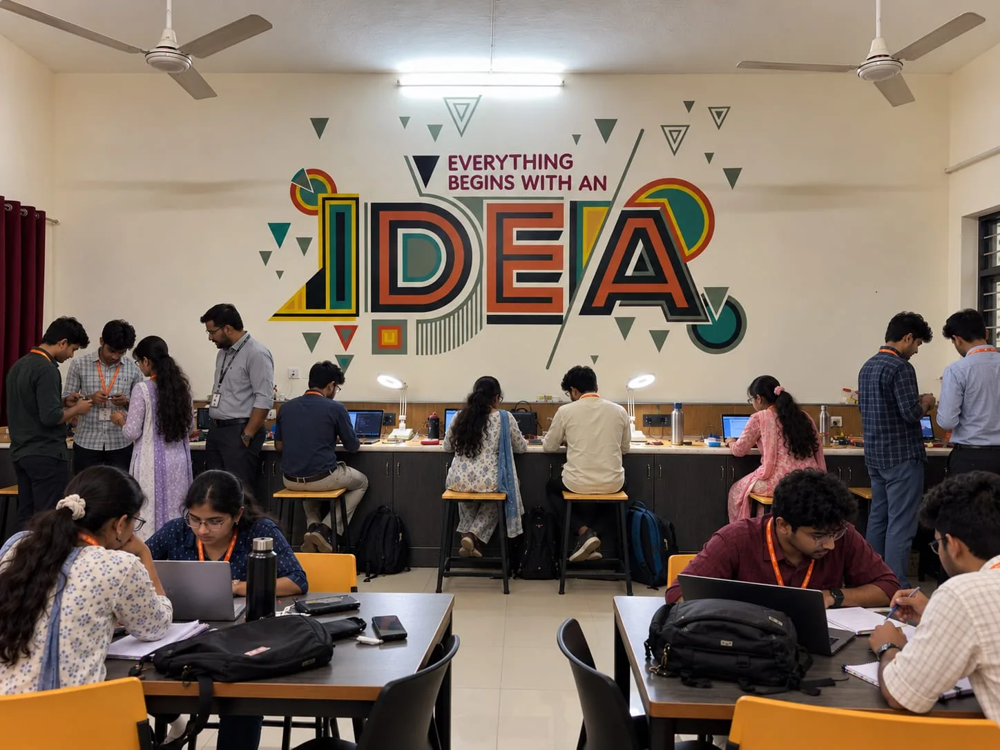

<div align="center">



# AICTE IDEA Lab

### Idea Development, Evaluation & Application

Official website of the AICTE IDEA Lab at **Kongunadu College of Engineering and Technology**, Trichy.

[](https://idealab-kncet.github.io/IdeaLab/)


[Visit the website](https://idealab-kncet.github.io/IdeaLab/) &nbsp;|&nbsp; [About](https://idealab-kncet.github.io/IdeaLab/about) &nbsp;|&nbsp; [Services](https://idealab-kncet.github.io/IdeaLab/services) &nbsp;|&nbsp; [Facilities](https://idealab-kncet.github.io/IdeaLab/facilities) &nbsp;|&nbsp; [Contact](https://idealab-kncet.github.io/IdeaLab/contact)

</div>

---

## Overview

The AICTE IDEA Lab gives students hands-on resources to turn STEM ideas into working
prototypes, open 24x7 and supported by training, mentoring, seed funding and incubation.

This website is the lab's public face. It presents the lab's vision, services, activities,
facilities and team to students, faculty, industry partners and visitors, and makes the
lab easy to find on search engines.

## What the website offers

| | |
| --- | --- |
| **Vision and mission** | The purpose of the lab and the innovation culture it builds on campus |
| **Services** | A single place to see how the lab supports an idea from concept to market |
| **Activities** | Workshops, bootcamps, programmes and events run through the year |
| **Facilities** | A photo tour of the equipment and spaces available to students |
| **Team** | The coordinators and people who run the lab |
| **Gallery and contact** | Lab photos, address, phone, email and opening hours |

## Site map

| Page | Route | Description |
| --- | --- | --- |
| Home | `/` | Overview, highlights and entry points to the rest of the site |
| About | `/about` | The lab and the AICTE IDEA Lab initiative |
| Vision & Mission | `/vision` | Goals and guiding principles |
| Services | `/services` | Everything the lab offers to innovators |
| Activities | `/activities` | Programmes, workshops and events |
| Facilities | `/facilities` | Equipment and infrastructure |
| Team | `/team` | People behind the lab |
| Gallery | `/gallery` | Photos from the lab |
| Contact | `/contact` | How to reach and visit the lab |

## Services at a glance

Training &middot; Seed Fund &middot; Development &middot; Mentoring &middot; Incubation &middot;
Internship &middot; Startup &middot; Commercialisation &middot; Consultancy &middot; Marketing &middot;
IPR &middot; Networking

## Activities

- Faculty Development Programmes (FDP)
- Skilling and professional skilling programmes
- Bootcamps and ideation workshops
- Industry awareness workshops
- Internship programmes
- School teachers' awareness and open day for school students
- Annual technical exhibitions
- Annual conference / symposium
- Newsletter, official website and knowledge portal

## Engineering highlights

- **Search-ready from the first byte.** Every route is prerendered to static HTML at build
  time, so search engines and link-preview bots see real titles, descriptions and content
  without running JavaScript.
- **Structured data.** `EducationalOrganization`, `BreadcrumbList` and `FAQPage` JSON-LD,
  plus per-page canonical and Open Graph tags, `robots.txt` and `sitemap.xml`.
- **Fast and lightweight.** Single-page React app on Vite, with all photos pre-resized
  (max 1600px) and served as WebP.
- **Responsive design.** Built to read well on phones, tablets and desktops.
- **Automated hosting.** Deployed to GitHub Pages by GitHub Actions on every push to `main`.

## Tech stack

| Layer | Technology |
| --- | --- |
| UI | React 19 |
| Build | Vite 7 |
| Routing | React Router 7 |
| SEO | react-helmet-async, JSON-LD, build-time prerendering with Puppeteer |
| Quality | ESLint 9 |
| Hosting | GitHub Pages (GitHub Actions) |

## Architecture

```
.
├── public/               Static assets: images, robots.txt, sitemap.xml
│   ├── facilities/       Facility photos
│   └── gallery/          Gallery photos
├── scripts/
│   └── prerender.js      Build-time static prerendering of every route
├── src/
│   ├── components/       Navbar, Footer, Seo, FaqSection
│   ├── pages/            One component per route
│   ├── App.jsx           Route definitions
│   └── main.jsx          Application entry point
└── vite.config.js        Build configuration
```

## Contact

<table>
  <tr>
    <td><strong>Address</strong></td>
    <td>AICTE IDEA Lab, Kongunadu College of Engineering and Technology, Trichy</td>
  </tr>
  <tr>
    <td><strong>Email</strong></td>
    <td><a href="mailto:idealab@kongunadu.ac.in">idealab@kongunadu.ac.in</a></td>
  </tr>
  <tr>
    <td><strong>Phone</strong></td>
    <td><a href="tel:+918680002425">+91 86800 02425</a></td>
  </tr>
  <tr>
    <td><strong>Website</strong></td>
    <td><a href="https://idealab-kncet.github.io/IdeaLab/">idealab-kncet.github.io/IdeaLab</a></td>
  </tr>
</table>

## Credits

Designed and developed by **Akhil R** and **Ravichandran P**, Final Year CSE (Batch 2023-2027),
Kongunadu College of Engineering and Technology.

<div align="center">

<sub>Content and branding belong to Kongunadu College of Engineering and Technology and AICTE.</sub>

</div>
